  
  
  
  
  

I'm an AI engineer in Bengaluru, working as an Associate Software Engineer (R&D) at Novulis Consulting. I build AI agents that hold up in real use: every model call has a way down, answers cite their sources, and an assistant acts only after a person confirms.

My portfolio has its own agent you can question, with its trace open: [mohammad-rizwan.tech/agent](https://mohammad-rizwan.tech/agent).

### Selected work

<table>
  <tr>
    <td width="50%" valign="top">
      
       <b>PACK</b>: seven LangGraph agents play Werewolf with a four-step model fallback, so a game never stalls. Built in a weekend at Monad Blitz Bangalore.
       <a href="https://mohammad-rizwan.tech/work/pack">Write-up</a> · <a href="https://github.com/rizwan2004cs/Agent-Werewolf">Code</a>
    </td>
    <td width="50%" valign="top">
      
       <b>CCR Compliance Advisor</b>: crawled 74,975 California regulation sections; every answer cites the section it comes from.
       <a href="https://mohammad-rizwan.tech/work/ccr">Write-up</a> · <a href="https://github.com/rizwan2004cs/ccr_web_crawler">Code</a> · <a href="https://ccr-compliance-agent.onrender.com/">Live</a>
    </td>
  </tr>
</table>

<b>Show 4 more projects</b>: FinBoom, Ten Days of Voice Agents, Campus Premier League, NGO Donor Matcher

 

<table>
  <tr>
    <td width="50%" valign="top">
      
       <b>FinBoom</b>: offline-first net-worth tracker whose assistant turns speech or text into one action and saves it only after you confirm.
       <a href="https://mohammad-rizwan.tech/work/finboom">Write-up</a> · <a href="https://github.com/rizwan2004cs/finboom">Code</a> · <a href="https://finboom-cyan.vercel.app">Live</a>
    </td>
    <td width="50%" valign="top">
      
       <b>Ten Days of Voice Agents</b>: nine voice agents of my own in Murf AI's challenge, on LiveKit, Deepgram and Gemini.
       <a href="https://mohammad-rizwan.tech/work/voice">Write-up</a> · <a href="https://github.com/rizwan2004cs/ten-days-of-voice-agents-2025">Code</a>
    </td>
  </tr>
  <tr>
    <td width="50%" valign="top">
      
       <b>Campus Premier League</b>: a live player auction for a college league, with AI commentary in Telugu.
       <a href="https://mohammad-rizwan.tech/work/cpl">Write-up</a> · <a href="https://github.com/rizwan2004cs/campus-league-auction-arena">Code</a> · <a href="https://campus-league-auction-arena.vercel.app">Live</a>
    </td>
    <td width="50%" valign="top">
      
       <b>NGO Donor Matcher</b>: donors find verified NGOs nearby and pledge exactly what they need. Spring Boot, React, Leaflet.
       <a href="https://mohammad-rizwan.tech/work/ngo">Write-up</a> · <a href="https://github.com/rizwan2004cs/NGO-Donor-Matcher-Frontend">Code</a> · <a href="https://ai-donor-matcher-frontend.vercel.app/">Live</a>
    </td>
  </tr>
</table>

All ten projects, with architecture diagrams: [mohammad-rizwan.tech](https://mohammad-rizwan.tech/#projects)

### Stack

  

AI: LangGraph · multi-agent systems · RAG with Pinecone · tool calling (Groq, OpenAI, Gemini) · model fallback chains · voice agents (LiveKit, Deepgram, Whisper) · prompt-injection guards

### Lately

- **Associate Software Engineer (R&D), Novulis Consulting** since June 2026, after an R&D internship there.
- **Won $115** at Superteam's Capture the Flag v2, a Solana security contest in Bengaluru.
- **Built DUO** at Impact Lab Bengaluru: a 4 ft rehab companion robot that turns exercise into play.
